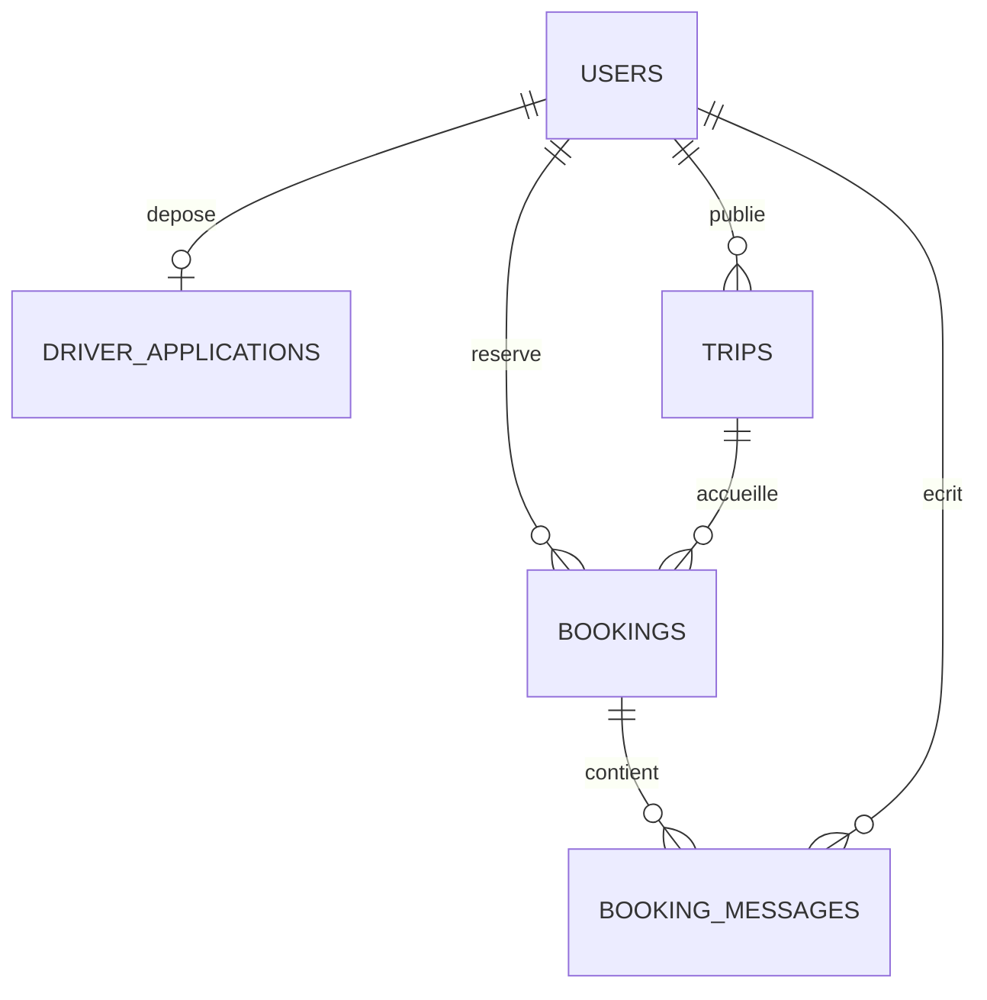

# Colisfirst

Plateforme pédagogique de livraison de colis entre la France et le Maghreb, construite avec Laravel 13, PHP, Blade, CSS, JavaScript et SQLite. Le starter Laravel conserve Fortify pour l’authentification et ses pages React pour les fonctions de sécurité avancées.

## Démarrage

Depuis ce dossier :

```sh
composer install
npm install
# Sur une nouvelle installation seulement : copier .env.example vers .env,
# créer database/database.sqlite et exécuter php artisan key:generate.
php artisan migrate
npm run build
php artisan serve
```

Ouvrir http://127.0.0.1:8000. Les nouvelles pages Blade utilisent directement `public/css/market.css` et `public/js/market.js`. Le build JavaScript sert aux écrans de sécurité du starter.

La base locale a déjà été migrée et remplie. Pour installer les exemples sur une autre machine, activer `MARKETPLACE_DEMO=true` dans un environnement local, puis exécuter :

```sh
php artisan db:seed --class=MarketplaceSeeder
```

Le seeder refuse de fonctionner en production. Il crée les comptes de démonstration et réinitialise leurs mots de passe ; ne jamais l’exécuter contre des données réelles. Il ne supprime pas les réservations existantes. Les dates des nouveaux exemples sont relatives au jour de leur création.

## Comptes de test

Mot de passe commun : `DemoColis2026!`.

| Rôle                | Adresse                  |
| ------------------- | ------------------------ |
| Client approuvé     | client@colisfirst.test   |
| Livreur Paris       | livreur@colisfirst.test  |
| Livreur Lyon        | livreur2@colisfirst.test |
| Livreuse Marseille  | livreur3@colisfirst.test |
| Administration      | admin@colisfirst.test    |
| Candidat en attente | candidat@colisfirst.test |

Les coordonnées, les justificatifs et les trajets sont fictifs. Une réservation `CF-DEMO2026` attend l’acceptation du livreur. Ne pas téléverser de véritables documents d’identité dans la démonstration.

## Parcours à présenter

1. Parcourir l’accueil et filtrer les trajets par ville, pays ou date.
2. S’inscrire : le compte reste en attente. Un administrateur peut accepter ou refuser la demande.
3. Se connecter en client approuvé et réserver un trajet : décrire les objets, renseigner le destinataire et accepter la déclaration.
4. Se connecter en livreur pour accepter ou refuser la demande.
5. Revenir en client et simuler le paiement. Les contacts et la conversation deviennent accessibles.
6. Le livreur confirme la prise en charge ; le client confirme la réception.
7. Déposer une candidature fictive, puis l’examiner en administrateur. Après approbation, le nouveau livreur peut publier un départ.

L’administration est accessible via « Mon espace » puis « Administration », ou `/administration`.

## Architecture et fichiers

| Responsabilité                         | Fichiers                                                                            |
| -------------------------------------- | ----------------------------------------------------------------------------------- |
| Routes publiques et espaces privés     | `routes/web.php`                                                                    |
| Comptes et authentification            | Fortify, `app/Actions/Fortify/CreateNewUser.php`                                    |
| Trajets, réservations et candidatures  | `app/Http/Controllers/MarketplaceController.php`                                    |
| Validation des comptes et des dossiers | `app/Http/Controllers/AdminController.php`                                          |
| Modèles métier                         | `app/Models/Trip.php`, `Booking.php`, `DriverApplication.php`, `BookingMessage.php` |
| Schéma SQL                             | `database/migrations/2026_09_30_000001_create_marketplace.php`                      |
| Données fictives                       | `database/seeders/MarketplaceSeeder.php`                                            |
| Mise en page commune                   | `resources/views/layouts/market.blade.php`                                          |
| Accueil et espaces                     | `resources/views/market/`                                                           |
| Inscription                            | `resources/views/register.blade.php`                                                |
| Connexion                              | `resources/views/auth/login.blade.php`                                              |
| Apparence et estimation du prix        | `public/css/market.css`, `public/js/market.js`                                      |
| Tests du métier                        | `tests/Feature/MarketplaceTest.php`                                                 |

`resources/views/app.blade.php` est désormais le conteneur Inertia du starter, pas l’accueil public. L’ancien formulaire de colis a été remplacé par le formulaire de réservation dans `market/trip.blade.php`.

## Base de données



- `users` : rôle (`client`, `driver`, `admin`), statut du compte, coordonnées et date d’acceptation des conditions.
- `driver_applications` : une candidature par utilisateur, statut, pièces privées et compte rendu de décision.
- `trips` : villes, pays, dates, points de ramassage, conditions, prix en centimes et capacité en kg.
- `bookings` : référence unique, déclaration horodatée et versionnée, destinataire, poids, détail du prix et état.
- `booking_messages` : échanges rattachés à une réservation.

Les tables d’authentification, sessions, cache et jobs du starter sont conservées. Une sauvegarde locale préalable se trouve dans `storage/app/backups/`.

## Règles métier et sécurité

- Un nouveau compte est toujours `client/pending`, quels que soient les champs envoyés par le navigateur.
- La publication exige un livreur approuvé. La réservation exige un compte approuvé.
- Un livreur ne peut pas réserver son propre trajet.
- Le prix est calculé côté serveur ; le total envoyé par le navigateur n’est pas utilisé.
- La capacité est réservée dès la demande et libérée en cas de refus ou d’annulation. Le verrou de transaction protège le contrôle de capacité.
- Les états possibles sont : `pending → accepted → confirmed → collected → delivered`, plus `rejected` et `cancelled` avant paiement.
- Le client confirme la réception ; le livreur ne peut pas le faire à sa place.
- Les documents sont dans `storage/app/private`, sans lien public. Leur téléchargement passe par un contrôle administrateur.
- Les coordonnées sont visibles aux parties seulement après confirmation, ainsi qu’à l’administration dans le cadre prévu.
- Les formulaires utilisent CSRF, validation serveur et échappement Blade. Certaines actions sont limitées en fréquence.
- Fortify gère le hachage des mots de passe, les sessions et la limitation des connexions.
- Le paiement est simulé uniquement avec `MARKETPLACE_DEMO=true` hors production. Aucun prestataire ni carte bancaire n’est sollicité.

## Modèle économique proposé

Le livreur fixe le prix du transport. La plateforme ajoute 12 % de frais de service, réglables dans `config/marketplace.php`. Exemple : 5 kg à 8 €/kg = 40 € de transport + 4,80 € de frais = 44,80 €.

Ce montant est une hypothèse de démonstration, pas une estimation de rentabilité : les frais du prestataire de paiement, les remboursements, les litiges, la fiscalité et le coût du support restent à chiffrer. Aucun reversement n’est exécuté. Une intégration de paiement de place de marché doit être conçue séparément avant de collecter des fonds.

La rétention repose sur le suivi, l’historique, la conversation et les déclarations. Masquer les contacts avant confirmation réduit l’échange direct, mais ne peut pas empêcher complètement les contournements ni le partage de contacts dans les textes libres.

## Vérifications

```sh
php artisan test
vendor/bin/pint --test
npm run build
```

Les tests métier couvrent les rôles, l’accès aux dossiers, les prix, les capacités, les transitions, l’inscription, les fichiers privés et le paiement de démonstration. Les tests utilisent une base SQLite en mémoire indépendante de la base locale.

## Limites avant de vrais clients

Cette version est une démonstration fonctionnelle, pas un service commercial prêt à ouvrir. Restent à finaliser : activation et validation Stripe Connect en environnement réel, gestion opérationnelle des remboursements et litiges, configuration et délivrabilité du fournisseur e-mail, assurance adaptée, qualification juridique des transporteurs et de la plateforme, obligations fiscales, règles douanières par destination, contrats et mentions de l’exploitant, validation des procédures RGPD et activation de la purge planifiée, supervision, sauvegardes et durcissement de l’hébergement.

Les cases d’acceptation horodatées ne sont pas une signature électronique qualifiée. Aucune décharge ne garantit l’absence de responsabilité en cas de transport illicite. Les candidatures de particuliers doivent faire l’objet d’un examen de l’éligibilité réelle au transport envisagé ; le statut de micro-entrepreneur ne suffit pas à lui seul.

Sources de cadrage consultées :

- [Douane : restrictions et interdictions](https://www.douane.gouv.fr/fiche/restriction-de-circulation-ou-interdiction-de-certaines-marchandises)
- [Ministère des Transports : accès à la profession](https://www.ecologie.gouv.fr/politiques-publiques/acces-exercice-profession-transporteur-marchandises)
- [CNIL : minimiser les données collectées](https://www.cnil.fr/fr/minimiser-les-donnees-collectees)

Pour préparer le DWWM, suivre le parcours de démonstration puis expliquer les routes, contrôleurs, relations SQL, validations et tests à partir du code. Adapter le projet et respecter les règles de déclaration d’assistance de l’organisme de formation.

## Paiements, e-mails et confidentialité (mise à jour octobre 2026)

Le bandeau général de démonstration et les flèches décoratives sont retirés. Le PNG du logo est affiché en entier. Les données fictives du seeder restent identifiées comme telles. Deux illustrations de préparation/remise de colis sont intégrées et signalées comme générées.

### Stripe Connect

Le code utilise Stripe Checkout hébergé et Connect Accounts v2 (livreurs Express, destination charges). La commission est calculée côté serveur. Les reversements vers le compte Stripe du livreur interviennent au paiement : **ce n’est pas un séquestre jusqu’à la livraison**. Les frais Stripe et les pertes peuvent être supportés par la plateforme. Les remboursements et litiges sont suivis via webhooks ; leur traitement opérationnel reste à organiser dans Stripe, y compris les reprises de transferts et commissions.

L’intégration est désactivée tant que la configuration manque. Renseigner dans `.env` (jamais dans Git) :

- `STRIPE_ENABLED=true`
- `STRIPE_SECRET` : clé secrète ou restreinte avec les autorisations requises
- `STRIPE_WEBHOOK_SECRET` : secret de signature du point de terminaison
- `STRIPE_LIVE=false` pour la validation en environnement de test ; `true` uniquement avec une configuration réelle correspondante
- `APP_URL` : URL publique HTTPS exacte

Créer le webhook `/stripe/webhook` pour `checkout.session.completed`, `checkout.session.async_payment_succeeded`, `checkout.session.async_payment_failed`, `checkout.session.expired`, `charge.refunded`, `charge.dispute.created`. Le retour navigateur ne confirme jamais un paiement. Les signatures, montant, devise, réservation et mode sont vérifiés ; les événements traités sont mémorisés. Le livreur approuvé et vérifié doit terminer son onboarding depuis `/livreur/paiements` avant de recevoir des paiements. Tester le parcours complet avec un compte Connect avant activation réelle. Aucune opération bancaire réelle n’a été exécutée pendant cette modification.

### Confirmation d’inscription

L’inscription déclenche une notification en français avec lien signé de vérification d’adresse. Le compte reste soumis à l’approbation administrative. Renseigner `MAIL_MAILER=smtp`, `MAIL_HOST`, `MAIL_PORT`, `MAIL_SCHEME`, `MAIL_USERNAME`, `MAIL_PASSWORD` (mot de passe d’application du fournisseur), `MAIL_FROM_ADDRESS`, `MAIL_FROM_NAME`. Le fournisseur et ses paramètres doivent correspondre au compte utilisé. Le mode actuel `log` ne livre pas d’e-mail à une boîte de réception.

Exécuter `php artisan config:clear` après configuration et maintenir `php artisan queue:work --tries=3` avec un superviseur sur le serveur. Vérifier une inscription réelle et la réception du message avant ouverture. Ne jamais communiquer les secrets dans une capture ou un dépôt.

### Données personnelles et textes

Pages : mentions légales, confidentialité, cookies, accessibilité et cadre réglementaire. Les champs `LEGAL_*` de `.env.example` servent à renseigner l’exploitant, l’hébergeur et les coordonnées. Ce sont des textes à compléter selon l’activité, pas une certification de conformité juridique. La page de cadre réglementaire cite les références officielles et distingue les obligations conditionnelles.

`/mes-donnees` permet l’export limité aux données personnelles prévues et la demande de droits. Les administrateurs répondent depuis leur tableau de bord. Une demande d’effacement n’efface pas automatiquement les obligations comptables ni les informations de tiers : elle doit être examinée et exécutée par l’exploitant. Les délais et procédures pour les données autres que les justificatifs restent à formaliser.

`php artisan privacy:purge-documents --dry-run` affiche le nombre de dossiers concernés. Sans `--dry-run`, les pièces privées sont supprimées 90 jours après examen, ou après création pour les dossiers non examinés ; ces derniers sont alors refusés pour expiration. Les fixtures partagées ne sont pas supprimées. La planification quotidienne est déclarée dans Laravel ; l’hébergement doit appeler `php artisan schedule:run` chaque minute. Aucune purge des données actuelles n’a été lancée pour cette mise à jour.

Le bandeau cookies explique les cookies essentiels uniquement. Aucun outil publicitaire ou d’audience ajouté. Le choix est mémorisé 180 jours et la fenêtre reste accessible dans le pied de page. Les durées sont documentées dans la politique cookies.

Validation locale : tests fonctionnels, PHPStan, formatage, compilation front et TypeScript. Le paiement réel, la délivrabilité SMTP et la conformité juridique finale restent non validés tant que les identifiants et les informations d’exploitation manquent.

## Dossiers client/livreur et support

Le tableau de bord donne accès à `/mon-dossier` (adresse, documents privés, activité professionnelle pour les livreurs et candidats) et `/support` (tickets et réponses). Pour une société : raison sociale, SIRET, forme juridique, représentant, adresse et contacts professionnels ; TVA facultative. Ces informations sont distinctes de la candidature initiale et ne modifient pas automatiquement son approbation.

Les justificatifs acceptent PDF/JPEG/PNG jusqu’à 5 Mo. Un remplacement supprime le fichier précédent du stockage actif et remet le document en attente d’examen. Une date d’expiration peut être renseignée ; un document expiré est signalé et ne peut pas être validé. Le téléchargement passe par une route authentifiée réservée au propriétaire ou à un administrateur approuvé. Aucun lien public vers les fichiers. Un contrôle de version empêche la validation d’une ancienne pièce pendant son remplacement.

Administration : « Dossiers et documents » donne accès aux coordonnées, sociétés et pièces actuelles de chaque utilisateur ; « Demandes de support » permet de répondre et clôturer les tickets. Une nouvelle réponse du client rouvre sa demande. L’espace reçoit les demandes 24 h/24 ; il ne prétend pas fournir une permanence humaine immédiate. Les réponses sont consultées dans l’espace support, sans notification e-mail ajoutée à ce parcours.

Les nouveaux dossiers sont inclus dans l’export personnel (sans contenu des pièces ni chemins privés). La politique de confidentialité décrit les documents et le support. Définir les durées de conservation de ces nouveaux documents avant ouverture commerciale ; la purge des candidatures initiales ne les concerne pas.

## Compléments du dossier DWWM

La comparaison avec le modèle de dossier a conduit aux ajouts suivants : édition d’un trajet futur sans réservation active (`TripEditController`), notifications internes pour les réservations et le support (`AccountAlert` et observers), protection de la suppression directe d’un compte possédant des dossiers/échanges, diagnostic de configuration `php artisan colisfirst:deployment-check` sans impression des secrets. Le diagnostic sort avec un code d’échec tant que les prérequis déclarés ne sont pas réunis ; il ne réalise aucun paiement ni test SMTP.

La migration des notifications est additive. L’édition d’un trajet contrôle à nouveau son propriétaire et ses réservations sous transaction. Les notifications sont créées en base, sans envoi de messages externes. Aucun événement antérieur à cet ajout n’est recréé artificiellement.

Le dossier PDF est livré dans `../output/pdf/ColisFirst_Dossier_projet_Rayane_Kacha.pdf`. Son générateur et son contenu sont conservés dans `docs/dwwm/source`, avec l’export navigateur utilisé. La grille `docs/dwwm/audit.csv` sépare les fonctions réalisées, les documents produits et les prérequis d’exploitation encore ouverts. Les preuves locales sont dans `docs/dwwm/evidence`.

Le livret est une adaptation de 55 pages du plan fourni. Les exemples propres à la gestion de travaux sont remplacés par le métier des colis. Les schémas d’interface sont explicitement identifiés comme maquettes documentaires ; l’export du tableau de bord client est une capture réelle via impression navigateur. Il ne contient pas de faux justificatif de déploiement, de paiement ou de réception e-mail. La date d’examen et les détails non fournis du parcours restent à confirmer avant dépôt à l’école.


## Déploiement Vercel

La configuration est dans `vercel.json`, l’entrée Laravel dans `api/index.php` et les exclusions dans `.vercelignore`. Le stockage des justificatifs peut être sélectionné avec `PRIVATE_DOCUMENT_DISK=s3` ; le pilote S3 est installé. Les sessions et le cache doivent utiliser une base distante.

La tentative du 1er octobre 2026 est bloquée par Vercel : « Your Team exceeded our fair use limits and has been blocked. » Aucun projet ColisFirst ni aucune URL de production n’a été créé. La procédure de reprise, les variables et les vérifications sont dans [docs/deployment/vercel.md](docs/deployment/vercel.md). La compilation sur Vercel reste à vérifier après déblocage.

Une alternative Docker pour Render ou Railway est préparée dans [docs/deployment/docker.md](docs/deployment/docker.md), avec un `render.yaml` proposé pour Render. Le déploiement conserve `STRIPE_LIVE=false`; le diagnostic accepte une intégration Stripe de test avec `php artisan colisfirst:deployment-check --allow-stripe-test`. Cette option exige toujours des identifiants de test valides dans leur forme et n'active aucun paiement réel. Le compte d'hébergement, son budget, le SMTP et les mentions légales restent à renseigner avant publication complète.
